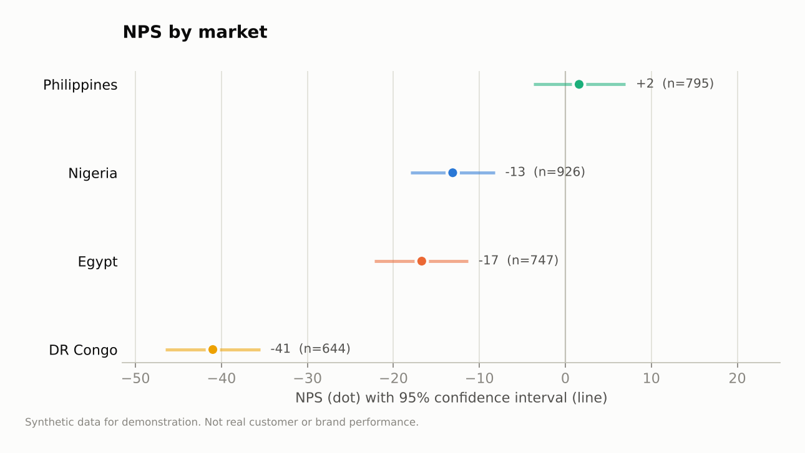
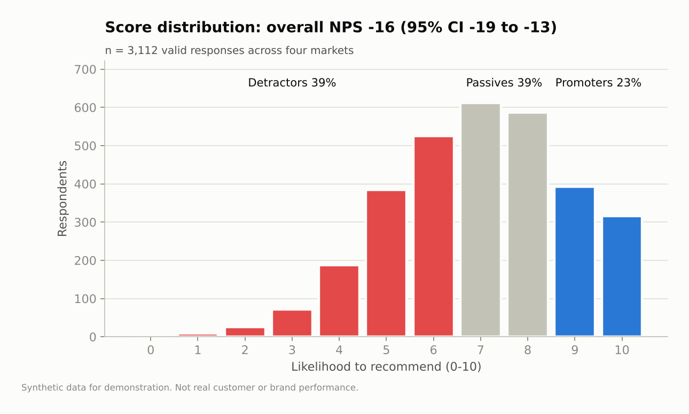
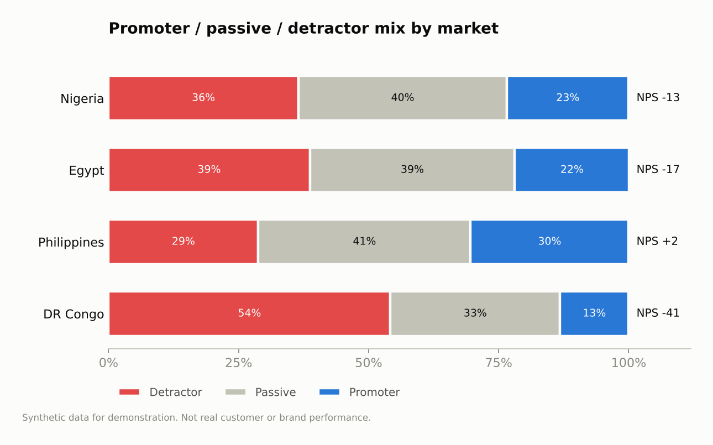
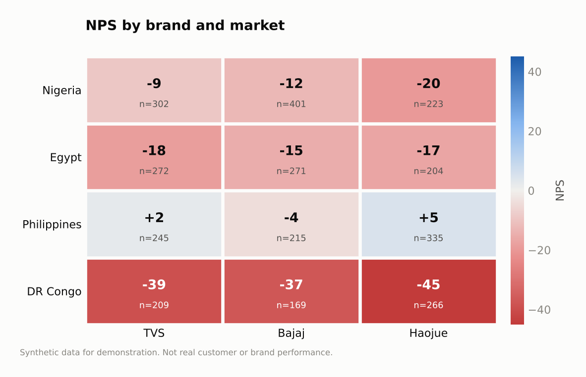
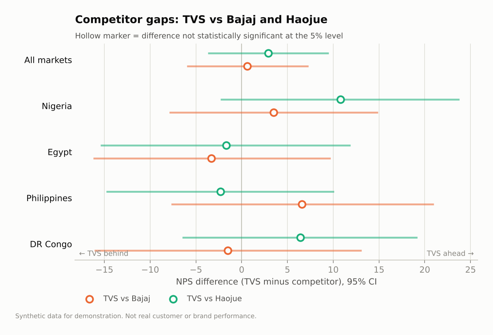
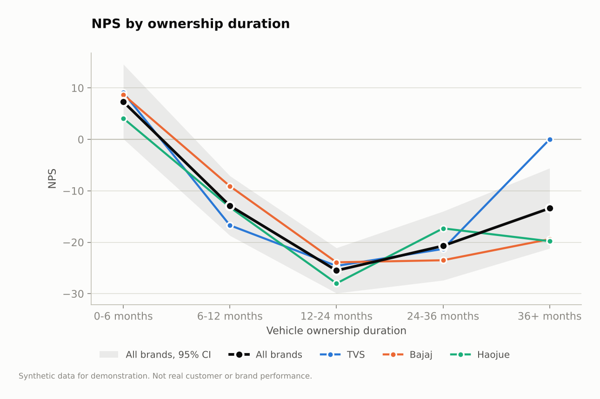
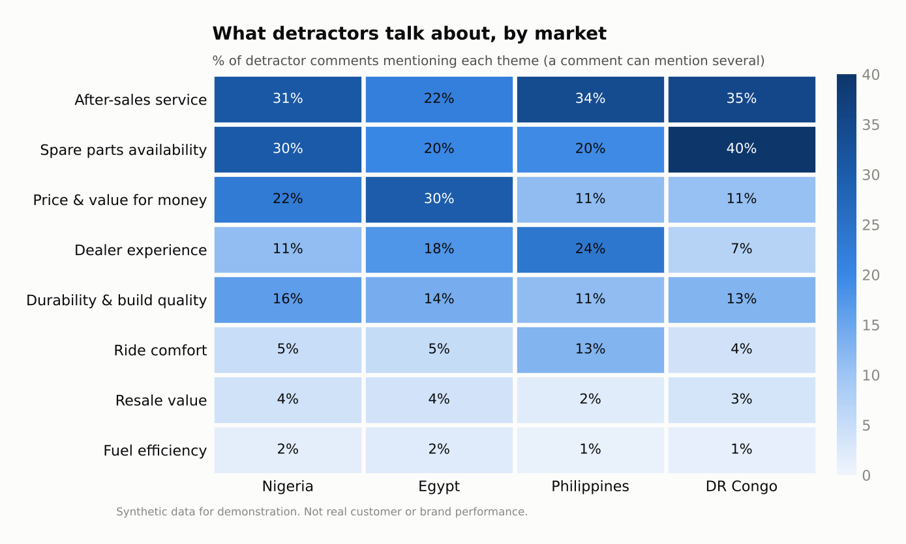

# Automotive Customer NPS & Feedback Analysis

An end-to-end customer-experience analysis of two-wheeler owners in **Nigeria, Egypt, the Philippines and DR Congo**. It covers data cleaning and validation, Net Promoter Score (NPS) with confidence intervals, segmentation by market, brand, ownership duration and usage, competitor comparison with significance testing, comment theme analysis, charts, an Excel workbook and a generated PDF report.

> **⚠️ All data and findings in this repository are synthetic.**
> This project reconstructs the *methods* of customer-experience research I carried out at The Digital Tantra. The original data is confidential and I no longer have access to it, so the dataset here is **generated by code** ([`generate_data.py`](src/nps_analysis/generate_data.py)) using documented assumptions ([`docs/synthetic_data_design.md`](docs/synthetic_data_design.md)).
> - It does **not** contain real customer responses or client results.
> - It does **not** describe the real performance of TVS, Bajaj or Haojue. The brand names are used only to make the competitor-comparison workflow realistic.



## Objectives

1. Build a realistic, messy survey dataset and clean it with transparent, logged rules.
2. Calculate NPS and segment customers into promoters, passives and detractors.
3. Analyse satisfaction by country, brand, vehicle ownership duration and usage type.
4. Compare the focus brand (TVS) with competitors (Bajaj, Haojue) in each market, using significance tests rather than raw score gaps.
5. Find recurring feedback themes in open-ended comments.
6. Produce charts, Excel-compatible tables and an analytical report with recommendations.

## Technology stack

Python 3.11+ · pandas · NumPy · Matplotlib · openpyxl (Excel) · ReportLab (PDF) · pytest

## Folder structure

```
automotive-customer-nps-feedback-analysis/
├── run_pipeline.py                  # one command: generate → clean → analyse → chart → report
├── src/nps_analysis/
│   ├── config.py                    # paths, categories, validation rules
│   ├── generate_data.py             # synthetic survey generator (seeded, documented assumptions)
│   ├── clean.py                     # cleaning + validation with an audit log
│   ├── metrics.py                   # NPS, confidence intervals, z-tests, FDR correction
│   ├── themes.py                    # keyword theme tagging, sentiment, n-grams
│   ├── visualize.py                 # charts (fixed, colour-blind-checked palette)
│   ├── analysis.py                  # runs every analysis, writes tables and figures
│   └── report.py                    # builds the Markdown + PDF report from computed results
├── data/
│   ├── raw/customer_feedback_synthetic_raw.csv        # 3,238 rows with injected errors
│   └── processed/customer_feedback_clean.csv          # 3,112 clean rows
│       processed/cleaning_log.csv                     # every rule and the rows it affected
├── outputs/
│   ├── figures/                     # 11 PNG charts
│   └── tables/                      # 16 CSV tables + nps_analysis_tables.xlsx
├── reports/
│   ├── nps_analysis_report.pdf      # 11-page analytical report
│   └── nps_analysis_report.md       # same content, readable on GitHub
├── docs/                            # synthetic data design, data dictionary
└── tests/test_nps_analysis.py       # 18 unit tests
```

## Installation

```bash
git clone https://github.com/<your-username>/automotive-customer-nps-feedback-analysis.git
cd automotive-customer-nps-feedback-analysis
python -m venv .venv
source .venv/bin/activate          # Windows: .venv\Scripts\activate
pip install -r requirements.txt
```

## Running

```bash
python run_pipeline.py                  # regenerate data and rebuild every output (about 10 seconds)
python run_pipeline.py --skip-generate  # reuse the existing raw CSV
python -m pytest -q                     # run the tests
```

You can also run each stage on its own from the `src` folder: `python -m nps_analysis.generate_data`, then `python -m nps_analysis.clean`.

All CSV files are UTF-8 with a byte-order mark, so they open correctly in Excel. `outputs/tables/nps_analysis_tables.xlsx` holds every table on its own sheet.

## Method

- **NPS** = % promoters (9-10) − % detractors (0-6), from −100 to +100.
- **Uncertainty:** 95% confidence intervals from the standard error of a three-category outcome, `SE = √[(p_P + p_D − NPS²) / n]`.
- **Group differences:** two-sided z-test for the difference of two NPS values. The ten TVS-vs-competitor comparisons are also corrected with the **Benjamini-Hochberg** false-discovery-rate method.
- **Small samples:** segments under 50 responses are flagged.
- **Themes:** comments are tagged with a transparent keyword dictionary, independently of the category the respondent ticked, so the two can be compared. Sentiment comes from cue words, and frequent phrases from bigram counts.
- **Method check:** because the generator's assumptions are known, the report tests whether the analysis recovers them.

## Results (on the synthetic data)

| Measure | Value |
|---|---|
| Valid responses | 3,112 (from 3,238 raw rows) |
| Overall NPS | **−16** (95% CI −19 to −13); 23% promoters, 39% passives, 39% detractors |
| By market | Philippines +2 · Nigeria −13 · Egypt −17 · DR Congo −41 |
| By brand | TVS −15 · Bajaj −15 · Haojue −18 (no significant differences after FDR correction) |
| By ownership | +7 at 0-6 months, lowest at 12-24 months (−26) |
| By usage | Personal −10 · Commercial −23 (significant) |
| Top detractor themes | After-sales service (30% of detractor comments), spare-parts availability (28%) |
| Category vs comment agreement | 85% (shows why coding the free text matters) |

| | |
|---|---|
|  |  |
|  |  |
|  |  |

The full write-up, including recommendations and a sample-size plan, is in [`reports/nps_analysis_report.pdf`](reports/nps_analysis_report.pdf) ([Markdown version](reports/nps_analysis_report.md)). The report text is generated from the computed tables, so it updates automatically if the data changes.

**Every result above reflects the assumptions built into the generator.** Their value is in showing that the pipeline recovers known effects, and that it does not overclaim small ones such as the brand gaps. They are not evidence about any real market or brand.

## Limitations

- **Synthetic data:** effect sizes, market mixes and comments are assumptions, not observations.
- **Template comments** are cleaner than real free text. Real data would need a larger theme dictionary, translation (Arabic, French, Filipino) or a trained text classifier.
- **Cross-sectional design:** ownership-duration differences compare different customers, not the same customers over time.
- **No survey weighting** to each market's sales mix, and no non-response adjustment by survey channel.
- **Static charts:** PNG output for the report and README. An interactive dashboard (e.g. Power BI) could be built on the clean CSV.

## Licence

MIT, see [LICENSE](LICENSE). The synthetic dataset is released under the same licence.
