# Automotive Customer NPS & Feedback Analysis
*Two-wheeler customer experience in Nigeria, Egypt, the Philippines and DR Congo: a demonstration on synthetic data*

Generated 21 November 2026 by `run_pipeline.py`.

## 1. Executive summary

**All data in this report is synthetic. It was generated by code in this repository to demonstrate the analysis method. It does not describe real customers, real survey results, any client engagement or the actual performance of TVS, Bajaj or Haojue. Brand names are used only to make the competitor-comparison workflow realistic.**

- Across 3,112 valid responses the overall NPS is **-16** (95% CI -19 to -13): 23% promoters, 39% passives and 39% detractors.
- The widest gap is between markets. Philippines is highest at +2 and DR Congo lowest at -41, a gap of 43 points with non-overlapping confidence intervals.
- Advocacy changes with ownership duration: NPS is +7 in the first six months and falls to -26 at 12-24 months. This 33-point drop is statistically significant (p < 0.05).
- Commercial riders (taxi / delivery) score 14 points below personal commuters; the difference is statistically significant (p < 0.05).
- Brand differences are small. TVS, Bajaj and Haojue sit between -18 and -15 overall, and 0 of 10 TVS-vs-competitor comparisons remain significant after correcting for multiple testing (0 before correction). The data does not support claiming that one brand leads.
- Detractors mostly talk about **after-sales service** (30% of detractor comments) and **spare parts availability** (28%). Promoters praise **fuel efficiency** and **durability & build quality**.

## 2. Objectives and approach

- Measure NPS and customer satisfaction (CSAT) overall and by market, brand, ownership duration and usage type.
- Compare the focus brand (TVS) with competitors (Bajaj, Haojue) within each market, with significance tests.
- Identify recurring feedback themes from open-ended comments and link them to detractors and promoters.
- Translate the findings into prioritised, testable recommendations.

NPS = % promoters (scores 9-10) minus % detractors (0-6), on a scale of -100 to +100. Confidence intervals use the standard error of a three-category outcome: SE = sqrt[(pP + pD - NPS²) / n]. Differences between two groups are tested with a two-sided z-test. Because the brand comparison involves ten tests, p-values are also adjusted with the Benjamini-Hochberg false-discovery-rate method. Segments with fewer than 50 responses are flagged as low-sample.

## 3. Data and cleaning

The raw export holds 3,238 rows: 3,112 unique respondents remain after cleaning (96.1%). Rows were dropped only where the respondent could not be identified or the NPS answer was unusable. Other problems (invalid satisfaction scores, implausible ownership durations, out-of-period dates) were set to missing so the rest of the response could still be used. Every rule is logged:

| Rule | Rows | Action |
|---|---|---|
| Rows in raw export | 3238 | - |
| Exact duplicate rows | 38 | dropped |
| Missing customer_id | 6 | dropped (cannot de-duplicate or trace) |
| Repeated customer_id | 0 | dropped, first response kept |
| Country spelling variants standardised | 166 | recoded |
| Unrecognised country | 0 | dropped |
| Brand spelling variants standardised | 102 | recoded |
| Unrecognised brand | 0 | dropped |
| NPS score missing | 38 | dropped (primary metric) |
| NPS score not a number (e.g. 'ten', 'n/a') | 19 | dropped (primary metric) |
| NPS score outside 0-10 | 25 | dropped (primary metric) |
| Satisfaction score outside 1-5 | 32 | set to missing, row kept |
| Satisfaction score missing | 46 | left missing, row kept |
| Ownership duration unparseable or blank | 25 | set to missing, band 'Unknown' |
| Ownership duration outside 0-120 months | 19 | set to missing, band 'Unknown' |
| Survey date in dd/mm/yyyy format | 62 | converted to ISO date |
| Survey date outside survey period | 12 | set to missing, row kept |
| Blank or placeholder comment | 94 | set to empty, row kept |
| Rows in clean dataset | 3112 | - |

## 4. Overall NPS

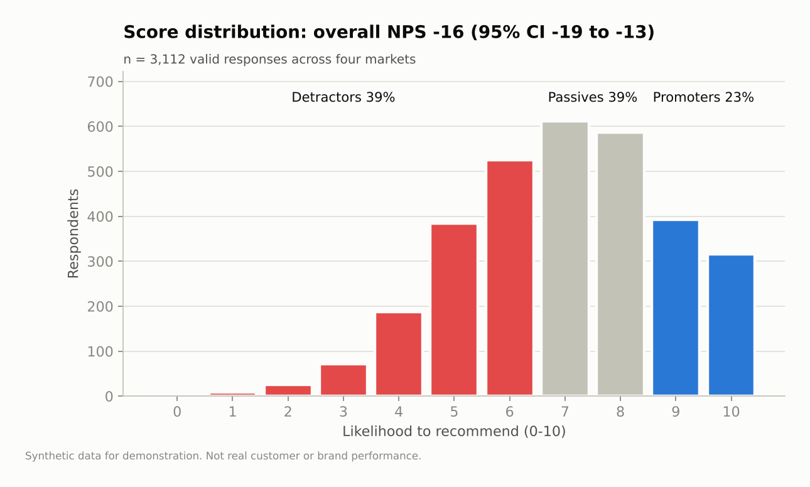

Mean CSAT is 3.78 out of 5. CSAT and likelihood to recommend are strongly related (Spearman rho = 0.75), but CSAT alone does not identify promoters: many customers who rate satisfaction 4/5 are still passives.

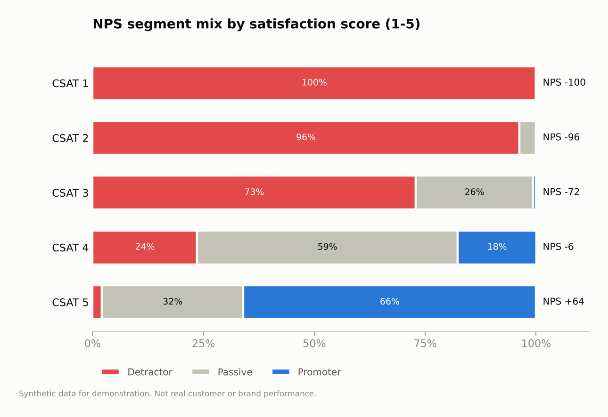

## 5. Satisfaction by market

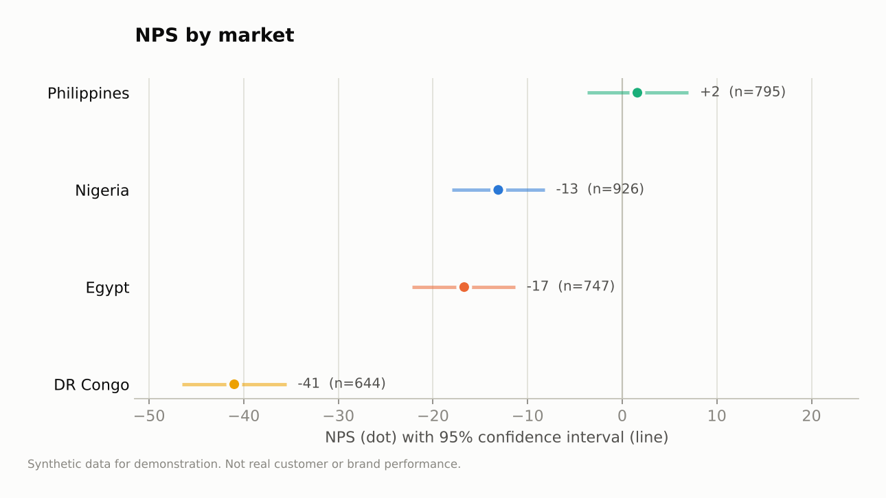

| Market | n | Prom % | Pass % | Det % | NPS | CI low | CI high | CSAT |
|---|---|---|---|---|---|---|---|---|
| Nigeria | 926 | 23.4 | 40.1 | 36.5 | -13.1 | -18.0 | -8.2 | 3.82 |
| Egypt | 747 | 22.0 | 39.4 | 38.7 | -16.7 | -22.2 | -11.3 | 3.74 |
| Philippines | 795 | 30.4 | 40.8 | 28.8 | 1.6 | -3.7 | 7.0 | 3.96 |
| DR Congo | 644 | 13.2 | 32.6 | 54.2 | -41.0 | -46.5 | -35.5 | 3.52 |

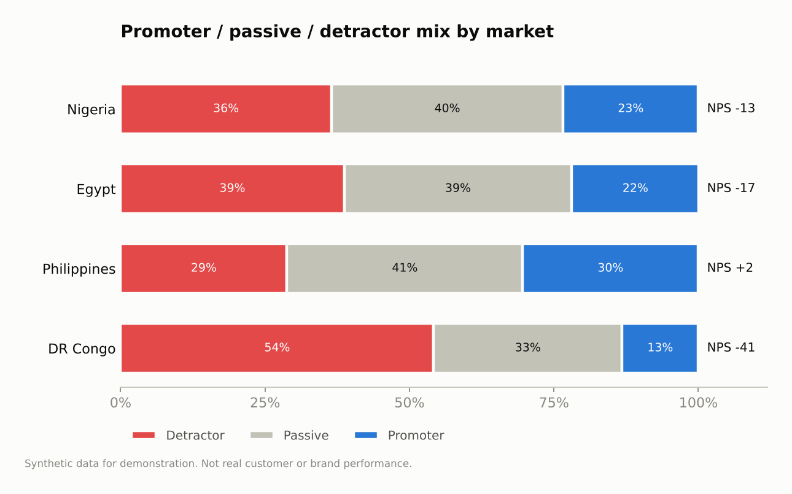

DR Congo combines the highest detractor share (54%) with the lowest promoter share (13%). Philippines has the most promoters (30%).

## 6. Competitor comparison

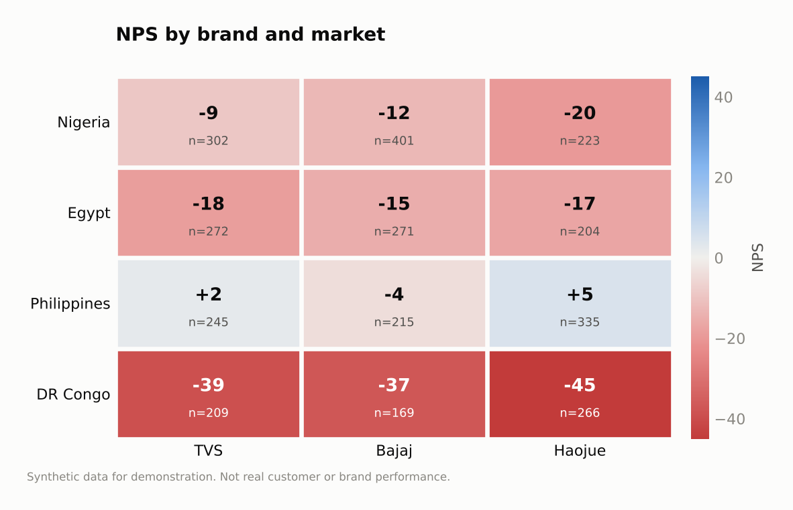

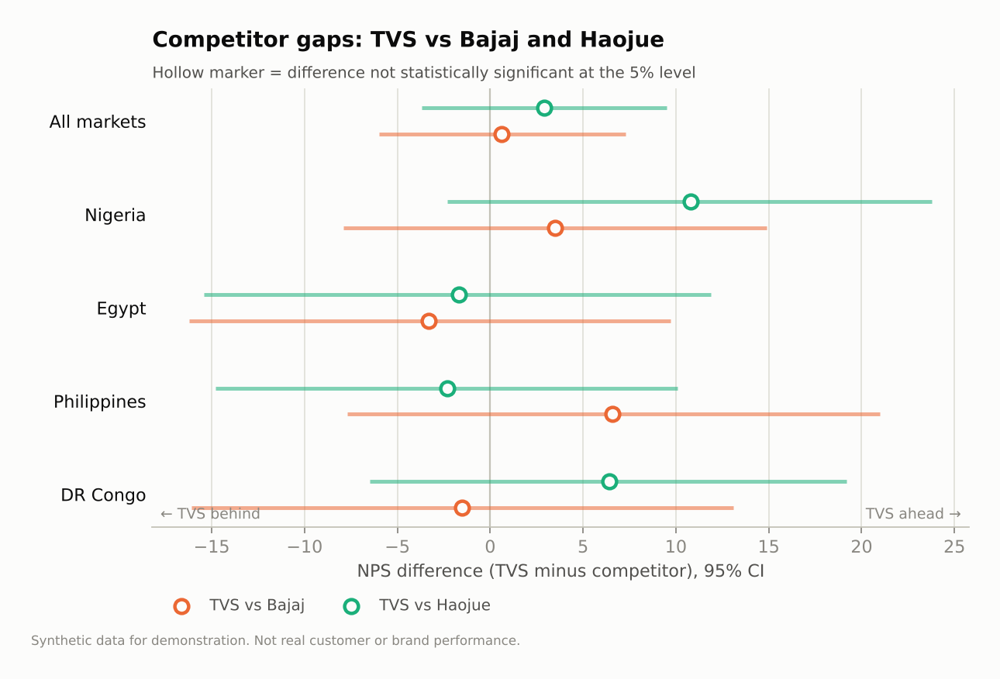

No TVS-vs-competitor difference is significant after correcting for multiple comparisons. The largest observed gap is +11 points (TVS vs Haojue in Nigeria, 95% CI -2 to +24). With roughly 200-350 owners per brand per market, the survey can only reliably detect gaps of about 19 NPS points or more (80% power, 5% significance). Smaller real differences would need larger samples.

| Market | Competitor | TVS NPS | Comp. NPS | Gap | CI low | CI high | p | p (FDR) |
|---|---|---|---|---|---|---|---|---|
| All markets | Bajaj | -14.8 | -15.4 | 0.6 | -6.0 | 7.3 | 0.8475 | 0.8475 |
| All markets | Haojue | -14.8 | -17.7 | 2.9 | -3.7 | 9.5 | 0.3859 | 0.8475 |
| Nigeria | Bajaj | -8.9 | -12.5 | 3.5 | -7.9 | 14.9 | 0.5447 | 0.8475 |
| Nigeria | Haojue | -8.9 | -19.7 | 10.8 | -2.3 | 23.8 | 0.1051 | 0.8475 |
| Egypt | Bajaj | -18.4 | -15.1 | -3.3 | -16.2 | 9.7 | 0.6213 | 0.8475 |
| Egypt | Haojue | -18.4 | -16.7 | -1.7 | -15.4 | 11.9 | 0.8053 | 0.8475 |
| Philippines | Bajaj | 2.4 | -4.2 | 6.6 | -7.7 | 21.0 | 0.3649 | 0.8475 |
| Philippines | Haojue | 2.4 | 4.8 | -2.3 | -14.8 | 10.1 | 0.7146 | 0.8475 |
| DR Congo | Bajaj | -38.8 | -37.3 | -1.5 | -16.1 | 13.1 | 0.8424 | 0.8475 |
| DR Congo | Haojue | -38.8 | -45.1 | 6.4 | -6.5 | 19.2 | 0.3323 | 0.8475 |

## 7. Ownership duration and usage

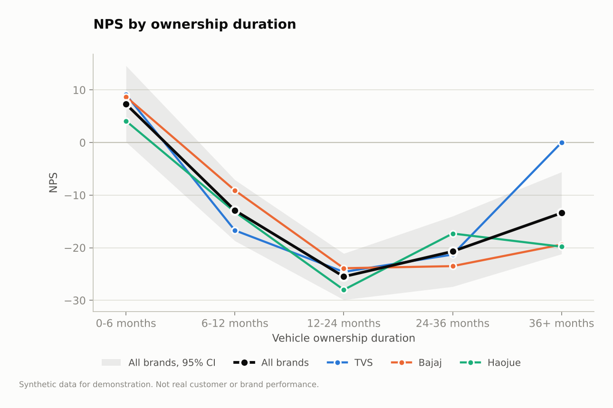

| Ownership | n | NPS | CI low | CI high | CSAT | Low n |
|---|---|---|---|---|---|---|
| 0-6 months | 449 | 7.3 | 0.1 | 14.6 | 4.02 | no |
| 6-12 months | 690 | -12.9 | -18.7 | -7.1 | 3.81 | no |
| 12-24 months | 1063 | -25.5 | -29.9 | -21.1 | 3.67 | no |
| 24-36 months | 492 | -20.7 | -27.4 | -14.0 | 3.72 | no |
| 36+ months | 374 | -13.4 | -21.2 | -5.6 | 3.8 | no |
| Unknown | 44 | -40.9 | -61.1 | -20.7 | 3.7 | yes |

The dip at 12-24 months matches the period when owners typically face their first major service and warranty expiry, so after-sales experience in year two is a likely lever. This is a hypothesis to test, not something this data proves. The 'Unknown' band holds respondents whose ownership answer was invalid; it is flagged as low-sample.

| Usage | n | Prom % | Det % | NPS | CI low | CI high |
|---|---|---|---|---|---|---|
| Personal commuting | 1638 | 25.8 | 35.3 | -9.5 | -13.3 | -5.8 |
| Commercial (taxi / delivery) | 1474 | 19.3 | 42.5 | -23.1 | -27.0 | -19.3 |

## 8. Feedback themes

Comments were tagged with a transparent keyword dictionary (src/nps_analysis/themes.py), independently of the category the respondent selected. The selected category matches the comment text for 85.1% of the 3,018 commented responses, and 232 comments were too vague to tag (e.g. 'Not happy.'). Coding the text, rather than relying only on the category field, avoids misreading the drivers.

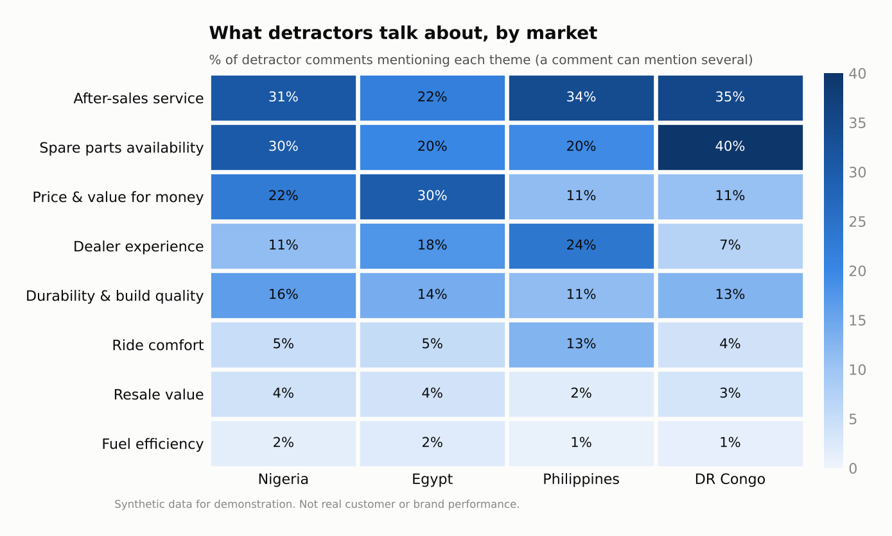

Leading detractor theme by market: Nigeria: after-sales service (31%); Egypt: price & value for money (30%); Philippines: after-sales service (34%); DR Congo: spare parts availability (40%).

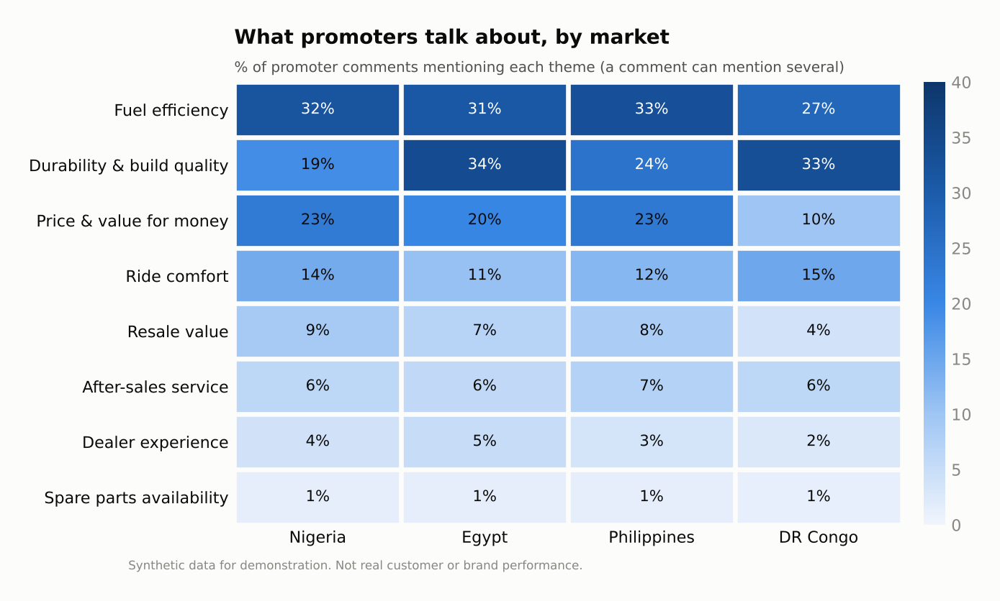

| Detractor phrase | Count | Promoter phrase | Count  |
|---|---|---|---|
| spare parts | 199 | excellent fuel | 60 |
| service centre | 85 | fuel economy | 60 |
| centre waiting | 85 | economy compared | 60 |
| waiting time | 85 | compared old | 60 |
| time long | 85 | good mileage | 54 |
| instalment payments | 80 | mileage spend | 54 |
| payments hard | 80 | spend fuel | 54 |
| hard rising | 80 | fuel week | 54 |

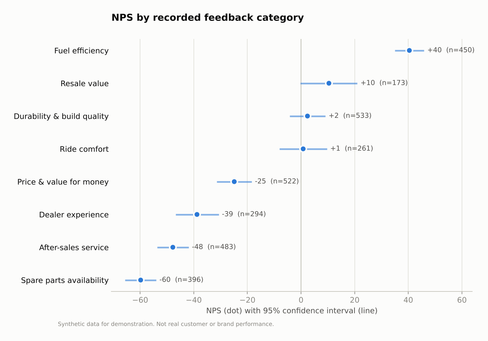

By recorded category, responses filed under 'Spare parts availability' have the lowest NPS (-60) and 'Fuel efficiency' the highest (+40).

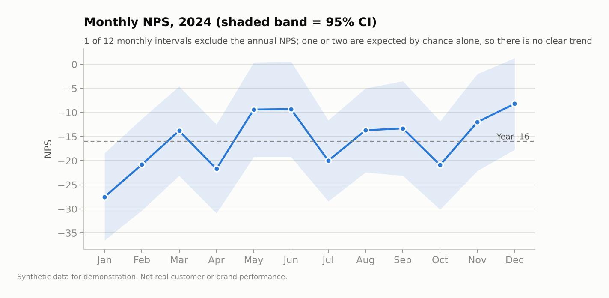

## 9. Recommendations

Ranked by how often the theme appears in detractor comments. Each should be piloted and measured (e.g. a before/after NPS read in the affected market), not rolled out on this analysis alone.

- **After-sales service** (most cited in DR Congo, Philippines, Nigeria, Egypt): Shorten service turnaround: appointment slots, a target waiting time per visit and a follow-up call when a fault is not fixed first time.
- **Spare parts availability** (most cited in DR Congo, Nigeria): Improve genuine spare-parts stocking outside major cities (regional depots, minimum stock lists for high-wear parts) and track fill rates.
- **Price & value for money** (most cited in Egypt): Strengthen value messaging and financing: transparent pricing, longer instalment options and total-cost-of-ownership comparisons.
- **Dealer experience** (most cited in Philippines): Set dealer service standards for paperwork and delivery times, and score dealers on post-sale follow-up.
- **Year-two retention:** add a proactive check-up offer around months 12-18, when NPS is lowest.
- **Commercial riders:** design a fleet / high-mileage service plan, since commercial users score lower than personal users.
- **Measurement:** to detect brand gaps of about 10 NPS points within a market, plan for roughly 920 responses per brand per market (80% power, 5% significance), and keep the open-ended question, because it explains the score.

## 10. Method check and limitations

Because the data is synthetic, the generator's built-in assumptions are known. Checking whether the analysis recovers them shows the method works. It does not mean the results describe a real market.

| Assumption built into the generator | What the analysis found | Recovered |
|---|---|---|
| Market ranking (best to worst): Philippines > Nigeria > Egypt > DR Congo | Philippines > Nigeria > Egypt > DR Congo | True |
| Lowest advocacy in the 12-24 months ownership band | Lowest NPS in the 12-24 months band | True |
| Commercial riders less likely to recommend than personal users | Gap +13.6 NPS points (p < 0.001) | True |
| Small brand effects (max spread 0.35 points on the 0-10 scale) | 0 of 10 brand comparisons significant after FDR correction | n/a (expected to be hard to detect) |
| About 8% of responses filed under the wrong category | Recorded category matches comment text for 85.1% of comments | True |

- Synthetic data: effect sizes, comments and market mixes are assumptions (documented in docs/synthetic_data_design.md).
- Comment templates are simpler than real free text. Real comments would need a larger dictionary, translation (Arabic, French, Filipino) or a trained classifier.
- Cross-sectional survey: ownership-duration effects compare different customers, not the same customers over time.
- No weighting: in a real study, results would be weighted to each market's sales mix and checked for non-response bias by survey channel.
